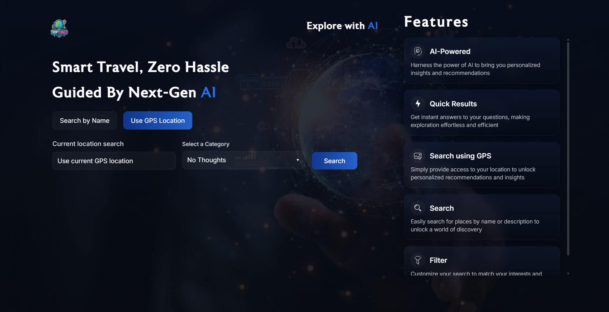
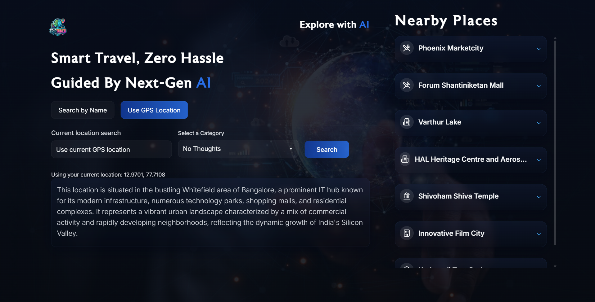

# TripTuned AI

## Project Overview

TripTuned AI is a smart travel assistant built with Next.js that helps users explore destinations using either place name search or GPS location. It leverages AI to generate concise destination summaries and nearby place recommendations while keeping the interface simple and travel-focused.

## Features

- Search by place name or use current GPS location
- Category selection with a default "No Thoughts" option
- Intelligent AI-generated location summaries and nearby place suggestions
- Search button disabled while waiting for GPS location or name input
- Responsive, glassmorphism-inspired UI for a polished travel experience

## Tech Stack

- Next.js (React framework)
- TypeScript
- Tailwind CSS for styling
- Google Generative AI (Gemini API)

## How It Works

1. **Choose a search mode**: Users can select either `Search by Name` or `Use GPS Location`.
2. **Enter a place name**: In name mode, type a location and optionally choose a category.
3. **Use GPS**: In GPS mode, the app requests current location permission and uses coordinates to generate nearby points of interest.
4. **AI-powered results**: The app sends the search request to the backend AI route and receives a clear summary plus nearby places in a consistent format.
5. **Nearby places panel**: Results appear with suggested destinations and links for further exploration.

## Setup and Installation

1. Clone the repository
2. Install dependencies:

```bash
npm install
```

3. Ensure your local Node.js version is 20 or higher.
   - If you use nvm: `nvm install 20 && nvm use 20`

4. Set up environment variables:
   - Create a `.env.local` file in the root directory
   - Add your Google Gemini API key: `NEXT_PUBLIC_GOOGLE_GEMINI_API_KEY=your_api_key_here`
4. Run the development server:

```bash
npm run dev
```

5. Open `http://localhost:3000` in your browser

## Deployment

Deploy on Vercel, Netlify, or any platform that supports Next.js. Configure the required environment variables in deployment settings, and use Node 20+ for builds.

## Project Notes

- Category resets to default when switching between name and GPS search modes.
- GPS search shows a disabled state while fetching current location.
- The app uses AI prompts to keep responses short, travel-centered, and formatted for readability.

## License

This project is licensed under the MIT License.

## Screenshots

### Landing page



### Search results view


